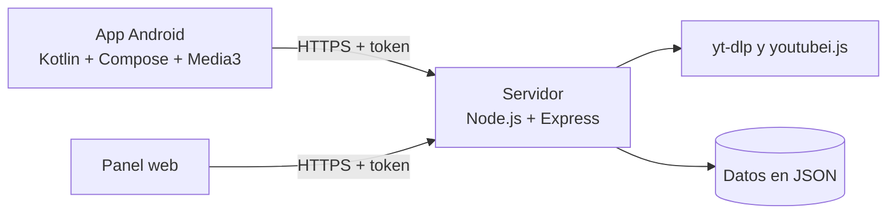

# MyMusic

Reproductor de música propio: **servidor, app Android nativa y panel web**. Busca en varias plataformas y reproduce al momento, con listas, radio y recomendaciones propias.

> Proyecto personal sin ánimo de lucro, de uso privado.

## Qué hace

- **Búsqueda y reproducción al momento** desde YouTube, YouTube Music y SoundCloud, canción a canción: el servidor lleva la sesión y la cola.
- **Listas propias**, importación de listas de Spotify y YouTube por enlace, y «Me gusta».
- **Radio que aprende** de las canciones que saltas, por separado en cada radio.
- **Artistas y discos:** página de artista, discografía, seguir artistas y novedades en Inicio.
- **«Para ti»:** estadísticas de escucha y listas automáticas.
- **Varios usuarios**, con listas separadas y una sesión de escucha compartida entre los dispositivos de cada uno.
- **Canciones que fallan:** salto automático a la siguiente y opción de darles otro enlace.
- **Panel web** que se adapta al móvil, y vista de consumo por usuario.

## Arquitectura



En producción, el servidor corre en un móvil Android reutilizado como servidor casero (Termux y pm2) y se publica con Cloudflare Tunnel.

## Stack

- **Servidor:** Node.js, Express, yt-dlp, youtubei.js, spotify-url-info.
- **App:** Kotlin, Jetpack Compose (Material 3), Media3 (ExoPlayer y MediaSession), Coil.
- **Tests:** `node:test`, 201 tests en el servidor.

## Estructura

```
server/    API, panel web (server/web) y tests
android/   app nativa
mockups/   maquetas aprobadas antes de construir cada pantalla
```

## Arrancar en local

```bash
cd server
cp .env.example .env    # y rellénalo
npm install
npm test
npm start
```

La app se abre con Android Studio desde `android/`. El servidor al que se conecta por defecto está en `DEFAULT_SERVER`, dentro de `AppViewModel.kt`.

## Cómo se ha construido

Con **Claude Code** como agente de desarrollo. Cada pantalla tuvo su maqueta aprobada (`mockups/`) antes de construirse, y cada cambio se revisó y se probó antes de integrarlo.
